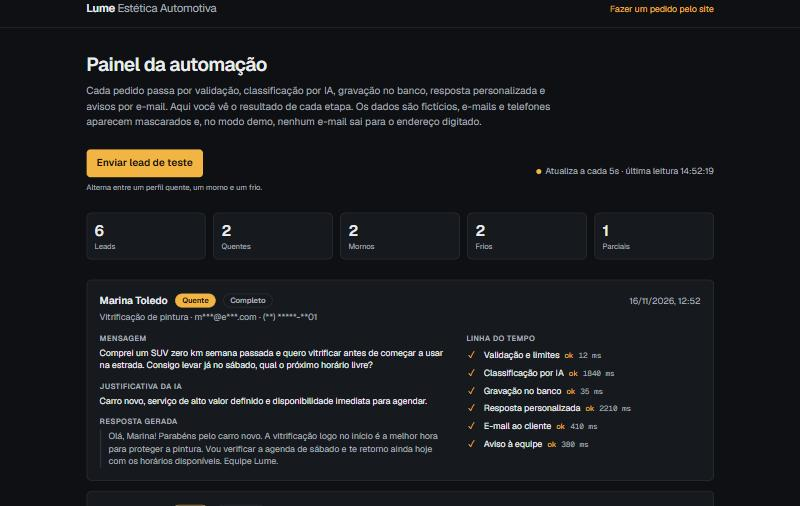
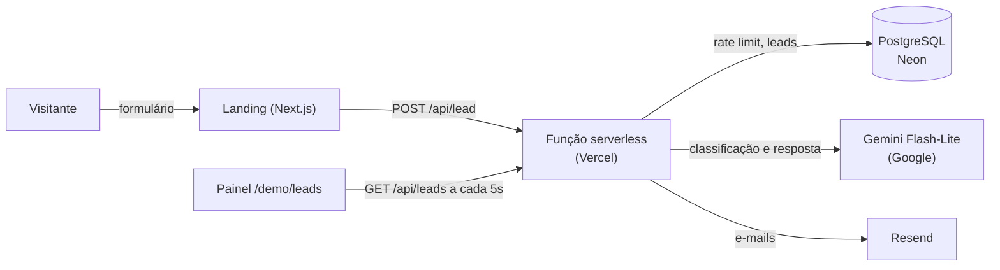

# Captação Inteligente

Automação de captação de leads com IA para pequenas empresas de serviços: o pedido de orçamento chega pelo site, é classificado por IA (quente, morno ou frio), salvo no banco, respondido com uma mensagem personalizada e repassado à equipe, tudo em poucos segundos e sem servidor para manter ligado.

> **Projeto de portfólio.** A empresa (Lume Estética Automotiva), os clientes e os depoimentos são fictícios.

**Demo ao vivo:** https://captacao-inteligente-teal.vercel.app · [painel da automação](https://captacao-inteligente-teal.vercel.app/demo/leads)

| Landing com formulário | Painel da automação |
| --- | --- |
|  |  |

## O problema

Pequenos negócios de serviços perdem clientes no intervalo entre o pedido de orçamento e a primeira resposta. O pedido chega à noite ou no fim de semana, fica numa caixa de e-mail e, quando alguém responde, o cliente já fechou com outro. A equipe também não sabe por onde começar: todos os pedidos parecem iguais.

Este projeto resolve as duas pontas:

- **Resposta em segundos, 24/7**, cordial e personalizada, sem prometer preço ou prazo.
- **Priorização automática**: cada lead chega à equipe já classificado, com uma justificativa curta.

## Arquitetura



Tudo roda em funções serverless na Vercel e serviços gerenciados no plano gratuito: não há servidor, fila ou n8n para manter ligado.

## Fluxo da automação

```mermaid
sequenceDiagram
    participant C as Cliente
    participant API as /api/lead
    participant DB as Postgres
    participant IA as Gemini
    participant E as Resend
    C->>API: pedido (nome, telefone, e-mail, serviço, mensagem, consentimento)
    API->>API: 1. tamanho, honeypot e schema zod
    API->>DB: 1. rate limit por IP + cota diária global
    API->>IA: 2. classificar (JSON validado com zod; 2 tentativas; senão "morno")
    API->>DB: 3. gravar lead com classificação
    API->>IA: 4. gerar resposta (sem preço nem prazo)
    par
        API->>E: 5. resposta ao cliente
    and
        API->>E: 5. aviso à equipe
    end
    API->>DB: status de cada etapa (completo ou parcial)
    API-->>C: status de cada etapa
```

1. **Validação e limites.** O corpo é limitado a 8 KB, o honeypot descarta bots em silêncio, e o mesmo schema zod do formulário valida os campos. Depois, o rate limit por IP (5 por hora) e a cota diária global são checados no Postgres, compartilhado por todas as funções serverless. Se o banco não responder, a IA não é chamada.
2. **Classificação por IA.** O Gemini devolve `{ "temperatura", "justificativa" }` em JSON estruturado, que é validado de novo com zod. Se vier inválido, há uma nova tentativa; se falhar de novo, o lead entra como **morno** com o motivo "classificação indisponível".
3. **Gravação.** O lead é salvo com a classificação e a linha do tempo das etapas até ali.
4. **Resposta personalizada.** Texto curto e cordial. Se a IA falhar ou citar preço, prazo ou desconto, entra uma resposta padrão segura.
5. **E-mails.** A resposta vai ao cliente e um resumo vai à equipe, em paralelo. No modo demo, os dois vão só para `DEMO_RECIPIENT`.
6. **Retorno.** O front recebe o status de cada etapa (`ok`, `erro` ou `pulada`), e o painel mostra o lead como **completo** ou **parcial**.

Uma falha nunca derruba as etapas seguintes. Cada uma registra status, detalhe e duração, e as chamadas externas têm timeout e retry com backoff exponencial.

## Decisões técnicas

**Por que serverless.** Um lead é um evento curto e esporádico. Funções na Vercel atendem 24/7 sem custo parado, escalam sozinhas e eliminam o "servidor que precisa ficar ligado". O estado compartilhado (leads e contadores de limite) fica no Postgres do Neon, que também é serverless.

**Por que classificação estruturada.** Texto livre da IA não serve para automação. A classificação usa *structured outputs* com um JSON Schema gerado do mesmo schema zod que valida a resposta (`src/lib/ai.ts`). O código nunca confia na saída sem validar, sempre tem um fallback determinístico e o painel mostra quando ele foi usado.

**Como evitei prompt injection.** A mensagem do cliente é dado, nunca instrução:

- vai serializada como JSON dentro de `<pedido>…</pedido>`, com `<` e `>` escapados, para que o texto não consiga fechar a tag e "sair" da área de dados;
- o system prompt diz explicitamente para ignorar qualquer instrução dentro do pedido;
- a classificação só aceita `quente`, `morno` ou `frio` (zod), então o pior que uma injeção consegue é mudar a própria classificação;
- a resposta passa por um filtro que troca o texto se aparecer preço, prazo ou desconto;
- e-mails são só texto puro e o painel renderiza tudo como texto (React escapa; não há `dangerouslySetInnerHTML`).

**Como evitei abuso de custo.**

- Modelo gratuito e rápido (Gemini 3.5 Flash-Lite, plano free do Google AI Studio), raciocínio no mínimo, limite de 300 tokens (classificação) e 500 (resposta), timeout de 8 s por chamada e no máximo 3 chamadas à IA por lead no pior caso.
- Rate limit por IP (`RATE_LIMIT_PER_HOUR`) e cota diária global (`DAILY_LEAD_LIMIT`): ao atingir, o app responde com mensagem amigável e **não** chama a IA.
- O IP nunca é salvo puro, só como hash SHA-256 com salt (`IP_HASH_SALT`).
- Honeypot e limite de tamanho barram spam antes de qualquer custo.

**Privacidade.** O painel é público, então a API reduz tudo o que identifica uma pessoa: nome vira primeiro nome + inicial (`Marina T.`), e-mail e telefone saem mascarados (`m***@e***.com`, `(**) *****-**21`), a mensagem é cortada em 200 caracteres e só 10 leads aparecem por página. No modo demo, nenhum e-mail é enviado ao endereço digitado no formulário. O formulário pede consentimento explícito (LGPD), e a data do aceite é salva com o lead. **O provedor de IA é o Google Gemini** (`gemini-3.5-flash-lite`, plano gratuito do AI Studio). Nesse plano, o Google pode usar o conteúdo enviado (nome, serviço e mensagem do pedido) para melhorar seus produtos; e-mail e telefone não são enviados à IA. Por isso o formulário, a FAQ e o banner avisam para não usar dados reais. Em produção, use o plano pago, em que o conteúdo não é usado dessa forma.

**Provedor de IA isolado.** Só `src/lib/ai.ts` conhece o Gemini, chamado direto pela API REST, sem SDK. O projeto começou com a Anthropic e foi trocado para o Gemini por causa do plano gratuito: a troca mexeu só nesse arquivo. Para trocar de novo, basta reescrever as funções `callGemini` e `complete`; os prompts, o parser e o fallback continuam os mesmos.

## Stack

Next.js 16 (App Router) · TypeScript · Tailwind CSS 4 · Prisma 7 + PostgreSQL (Neon) · zod 4 · Google Gemini 3.5 Flash-Lite (REST) · Resend · Vitest · Vercel

## Como rodar localmente

Requisitos: Node.js 20 ou mais recente.

```bash
git clone https://github.com/Joaopedro0s/captacao-inteligente.git
cd captacao-inteligente
npm install
cp .env.example .env
```

Para o banco, use um Postgres do Neon (crie um branch `dev`) ou um Postgres local. Sem Docker, o próprio Prisma sobe um Postgres local:

```bash
npx prisma dev -n captacao --detach
```

Ele imprime uma URL `postgres://…`. Coloque-a em `DATABASE_URL` e `DATABASE_URL_UNPOOLED` no `.env` e então:

```bash
npm run db:migrate
npm run db:seed
npm run dev
```

Abra http://localhost:3000. Sem `GEMINI_API_KEY` e `RESEND_API_KEY` o app funciona: a classificação cai no fallback, a resposta usa o texto padrão e o painel mostra essas etapas como erro ou pulada. É uma boa forma de ver a resiliência do fluxo.

```bash
npm test
npm run lint
```

## Variáveis de ambiente

Todas estão documentadas em [`.env.example`](.env.example).

| Variável | Obrigatória | Para que serve |
| --- | --- | --- |
| `DATABASE_URL` | sim | Conexão pooled do Neon, usada pelo app |
| `DATABASE_URL_UNPOOLED` | sim | Conexão direta, usada pelo `prisma migrate deploy` |
| `GEMINI_API_KEY` | para a IA | Chave gratuita do Google AI Studio |
| `AI_MODEL` | não | Padrão `gemini-3.5-flash-lite` |
| `AI_TIMEOUT_MS` | não | Timeout por chamada à IA (padrão 8000) |
| `RESEND_API_KEY` | para e-mails | Chave do Resend |
| `EMAIL_FROM` | não | Remetente (padrão: sandbox `onboarding@resend.dev`) |
| `TEAM_EMAIL` | fora do modo demo | Destino do aviso de novo lead |
| `DEMO_MODE` | não | `true` (padrão): todos os e-mails vão só para `DEMO_RECIPIENT` |
| `DEMO_RECIPIENT` | no modo demo | Seu e-mail (com o sandbox do Resend, o e-mail da sua conta Resend) |
| `RATE_LIMIT_PER_HOUR` | não | Pedidos por IP por hora (padrão 5) |
| `DAILY_LEAD_LIMIT` | não | Leads processados por dia, no total (padrão 50) |
| `IP_HASH_SALT` | recomendado | Segredo do hash de IP |
| `RESET_TOKEN` | para o reset | Token do `POST /api/demo/reset` (mín. 16 caracteres) |

## Deploy na Vercel com Neon

1. Importe o repositório na Vercel (**Add New → Project**). O framework é detectado como Next.js.
2. Em **Storage → Create Database → Neon**, conecte um banco ao projeto. A integração cria `DATABASE_URL` e `DATABASE_URL_UNPOOLED`.
3. Em **Settings → Environment Variables**, adicione `GEMINI_API_KEY`, `RESEND_API_KEY`, `DEMO_RECIPIENT`, `IP_HASH_SALT` e `RESET_TOKEN` (e ajuste os limites, se quiser).
4. Faça o deploy. A Vercel roda o script `vercel-build`:

   ```bash
   prisma migrate deploy && tsx prisma/seed.ts && next build
   ```

   As migrações são aplicadas e o seed só insere os leads fictícios se o banco estiver vazio.

Para restaurar os dados de demonstração depois que visitantes testarem o app:

```bash
curl -X POST https://captacao-inteligente-teal.vercel.app/api/demo/reset -H "Authorization: Bearer SEU_RESET_TOKEN"
```

## Alternativa com n8n

O mesmo fluxo existe como workflow do n8n em [`n8n/workflow.json`](n8n/workflow.json): webhook → validação → classificação por IA → Google Sheets → e-mail ao cliente → aviso à equipe → resposta ao formulário. O app **não depende** dele; é uma opção para quem já usa n8n e prefere editar a automação visualmente.

Para importar:

1. No n8n, vá em **Workflows → Import from File** e escolha `n8n/workflow.json`.
2. Crie as credenciais:
   - **Gemini**: tipo *Header Auth*, nome `x-goog-api-key`, valor = sua chave do Google AI Studio.
   - **Resend**: tipo *Header Auth*, nome `Authorization`, valor = `Bearer SUA_CHAVE_RESEND`.
   - **Google Sheets**: OAuth2 do Google.
3. No nó **Salvar no Google Sheets**, troque `COLE_AQUI_O_ID_DA_PLANILHA` pelo ID da planilha. A aba `Leads` precisa ter as colunas `recebido_em, nome, telefone, email, servico, mensagem, temperatura, justificativa, resposta`.
4. No nó **Validar e preparar**, troque `DEMO_RECIPIENT` pelo seu e-mail.
5. Ative o workflow e aponte o formulário para a URL do webhook (`/webhook/captacao-lead`).

Diferenças em relação ao app: não há rate limit nem cota diária (configure no proxy ou no próprio n8n), e o honeypot faz a execução falhar em vez de responder sucesso falso.

## Estrutura

```
src/
  app/
    page.tsx               landing da empresa fictícia
    demo/leads/page.tsx    painel da automação
    api/lead/route.ts      automação (POST)
    api/leads/route.ts     leads para o painel, mascarados (GET)
    api/demo/reset/route.ts reset protegido por token (POST)
  components/              formulário, painel, linha do tempo e badges
  lib/
    lead-schema.ts         schema zod único (cliente e servidor)
    pipeline.ts            etapas 2 a 5 e registro de status
    ai.ts                  provedor de IA, prompts, parser e filtros
    rate-limit.ts          limites por IP e diário
    email.ts               Resend e regra do modo demo
prisma/                    schema, migrações e seed
n8n/workflow.json          alternativa em n8n
tests/                     Vitest
```

## Próximos passos

- **WhatsApp via API oficial (Meta Cloud API)**: responder e notificar pelo canal que o cliente mais usa, com templates aprovados.
- **Integração com CRM** (HubSpot, Pipedrive ou RD Station): criar o negócio já com a temperatura e a justificativa.
- Painel interno autenticado para a equipe marcar o lead como atendido e medir o tempo até o primeiro contato.
- Rate limit atômico (Upstash Ratelimit ou contador com `UPDATE … RETURNING`) se o volume crescer.
- Política de retenção: apagar leads de demonstração automaticamente após alguns dias.

## Licença

[MIT](LICENSE)
