# Captação Inteligente

Automação de captação de leads com IA para pequenas empresas de serviços: o pedido de orçamento chega pelo site, é classificado por IA (quente, morno ou frio), salvo no banco, respondido com uma mensagem personalizada e repassado à equipe, tudo em poucos segundos e sem servidor para manter ligado.

> **Projeto de portfólio.** A empresa (Lume Estética Automotiva), os clientes e os depoimentos são fictícios.

**Demo ao vivo:** https://captacao-inteligente-teal.vercel.app · [painel da automação](https://captacao-inteligente-teal.vercel.app/demo/leads)

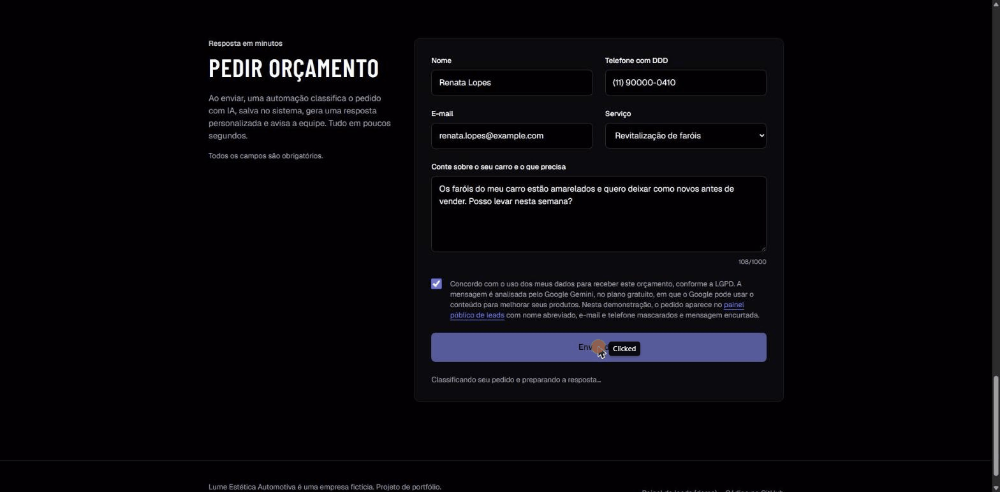

| Lead em **Processando** (resposta ainda sendo gerada) | Landing com prévia da automação |
| --- | --- |
| 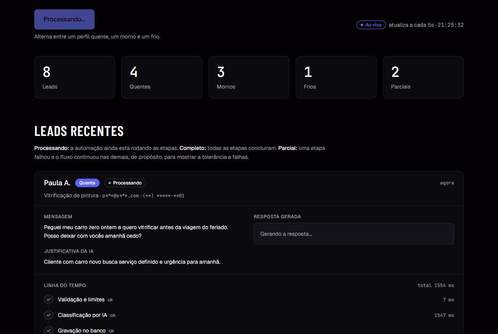 | 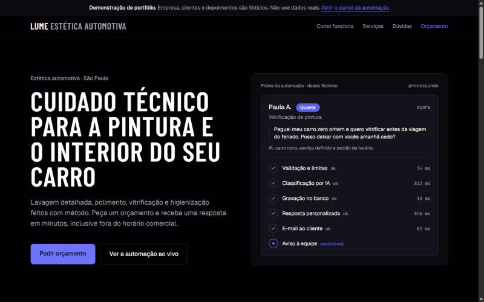 |

<details>
<summary>Celular e tablet (375, 390 e 768 px)</summary>

| 375 px | 390 px | 768 px |
| --- | --- | --- |
| 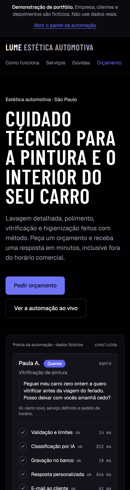 | 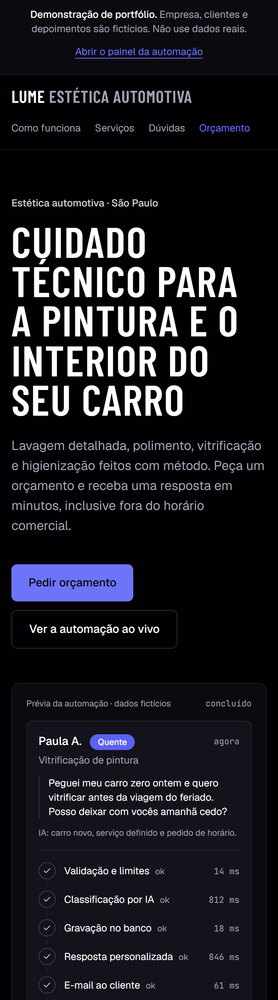 | 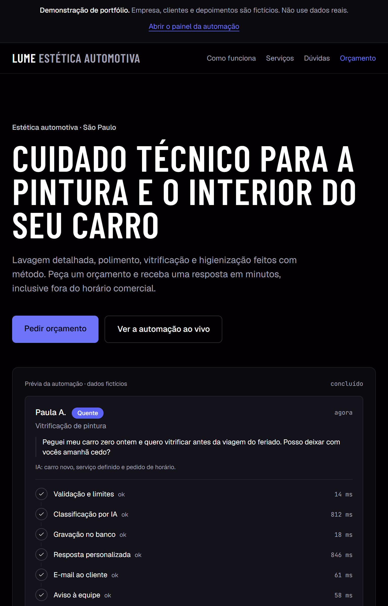 |
| 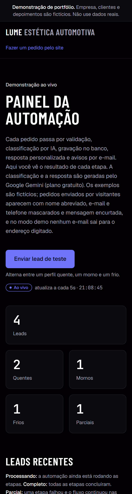 | 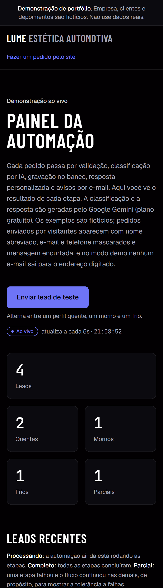 | 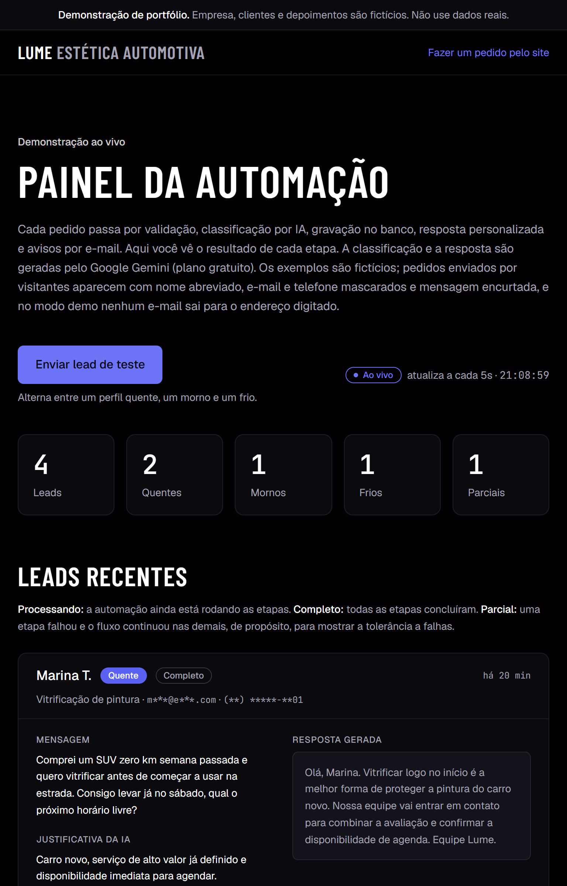 |

</details>

## O problema

Pequenos negócios de serviços perdem clientes no intervalo entre o pedido de orçamento e a primeira resposta. O pedido chega à noite ou no fim de semana, fica numa caixa de e-mail e, quando alguém responde, o cliente já fechou com outro. A equipe também não sabe por onde começar: todos os pedidos parecem iguais.

Este projeto resolve as duas pontas:

- **Resposta em segundos, 24/7**, cordial e personalizada, sem prometer preço ou prazo.
- **Priorização automática**: cada lead chega à equipe já classificado, com uma justificativa curta.

## Arquitetura

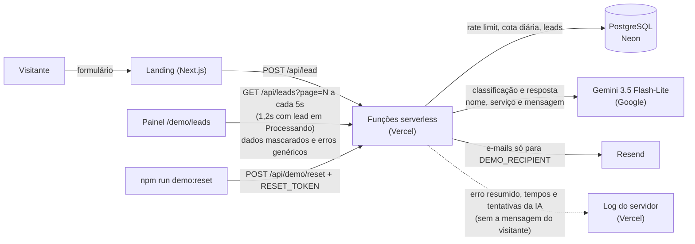

Tudo roda em funções serverless na Vercel e serviços gerenciados no plano gratuito: não há servidor, fila ou n8n para manter ligado.

## Fluxo da automação

```mermaid
sequenceDiagram
    participant C as Cliente
    participant API as /api/lead
    participant DB as Postgres
    participant IA as Gemini
    participant E as Resend
    C->>API: pedido (nome, telefone, e-mail, serviço, mensagem, consentimento)
    API->>API: 1. tamanho, honeypot e schema zod
    API->>DB: 1. rate limit por IP + cota diária global
    Note over API: cota esgotada: 429 amigável, sem chamar a IA
    par em paralelo
        API->>IA: 2. classificar (JSON validado com zod; senão "morno")
    and
        API->>IA: 4. gerar resposta (um parágrafo, sem preço nem prazo)
    end
    Note over API,IA: cada etapa de IA: até 4 s por tentativa, 1 retry, 8 s no total
    API->>DB: 3. gravar lead como PROCESSANDO (resposta "executando", e-mails "aguardando")
    API->>DB: resposta pronta: e-mails "executando"
    par
        API->>E: 5. resposta ao cliente
    and
        API->>E: 5. aviso à equipe
    end
    API->>DB: status final: COMPLETO ou PARCIAL
    API-->>C: status de cada etapa, só com mensagens genéricas
```

Estados do lead no painel:

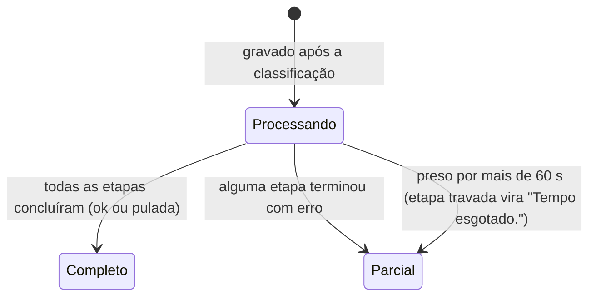

1. **Validação e limites.** O corpo é limitado a 8 KB, o honeypot descarta bots em silêncio, e o mesmo schema zod do formulário valida os campos. Depois, o rate limit por IP (5 por hora) e a cota diária global são checados no Postgres, compartilhado por todas as funções serverless. Se o banco não responder, a IA não é chamada.
2. **Classificação por IA.** O Gemini devolve `{ "temperatura", "justificativa" }` em JSON estruturado, que é validado de novo com zod. Se vier inválido, há uma nova tentativa dentro do mesmo limite de 8 s; se falhar, o lead entra como **morno** e a etapa fica com erro.
3. **Gravação.** Assim que a classificação termina, o lead é salvo como **Processando**, com as etapas seguintes como "executando" ou "aguardando". O painel já mostra o card, com "Gerando a resposta…".
4. **Resposta personalizada.** Começa junto com a classificação. Um parágrafo de até 3 frases, terminando em "Equipe Lume.", com o tom escolhido pelos mesmos critérios da classificação: objetivo para pedidos com intenção clara, sem pressão para quem ainda avalia e neutro para pedidos vagos, pedindo modelo do carro, estado atual e o que a pessoa quer melhorar. Se a IA passar de 8 s, citar preço, prazo ou desconto, ou vier cortada, entra o texto padrão da temperatura classificada e a etapa fica **ok (padrão)**. Erro da IA continua erro.
5. **E-mails.** A resposta vai ao cliente e um resumo vai à equipe, em paralelo. No modo demo, os dois vão só para `DEMO_RECIPIENT`.
6. **Retorno.** O front recebe o status de cada etapa (`ok`, `erro` ou `pulada`), e o lead termina como **Completo** ou **Parcial**.

Uma falha nunca derruba as etapas seguintes. Cada uma registra status, detalhe e duração, e as chamadas externas têm timeout e retry.

## Decisões técnicas

### Por que serverless

Um lead é um evento curto e esporádico. Funções na Vercel atendem 24/7 sem custo parado, escalam sozinhas e eliminam o "servidor que precisa ficar ligado". O estado compartilhado (leads e contadores de limite) fica no Postgres do Neon, que também é serverless. Por isso o rate limit não usa memória: cada invocação pode rodar numa instância diferente.

### Por que classificação estruturada

Texto livre da IA não serve para automação. A classificação usa *structured outputs* com um JSON Schema gerado do mesmo schema zod que valida a resposta (`src/lib/ai.ts`). O código nunca confia na saída sem validar, tenta de novo uma vez e, se ainda assim falhar, usa um fallback determinístico ("morno"). O painel mostra quando o fallback foi usado.

### Proteção contra prompt injection

A mensagem do cliente é dado, nunca instrução:

- vai serializada como JSON dentro de `<pedido>…</pedido>`, com `<` e `>` escapados, para que o texto não consiga fechar a tag e "sair" da área de dados;
- o system prompt diz explicitamente para ignorar qualquer instrução dentro do pedido; os critérios de tom da resposta também ficam no system prompt, nunca misturados à mensagem;
- a classificação só aceita `quente`, `morno` ou `frio` (zod), então o pior que uma injeção consegue é mudar a própria classificação;
- a resposta passa por um filtro que troca o texto se aparecer preço, prazo ou desconto;
- e-mails são só texto puro e o painel renderiza tudo como texto (React escapa; não há `dangerouslySetInnerHTML`).

Há testes que enviam uma mensagem tentando fechar a tag e confirmam que ela continua dentro da área de dados.

### Controle de custo

- Modelo gratuito da linha mais leve e rápida do Gemini (3.5 Flash-Lite, plano free do Google AI Studio), raciocínio no mínimo, limite de 300 tokens na classificação e 256 na resposta.
- Cada etapa de IA tem até 4 s por tentativa, no máximo 1 nova tentativa (backoff de 250 ms) e 8 s no total. Isso limita o pior caso a 2 chamadas por etapa.
- Rate limit por IP (`RATE_LIMIT_PER_HOUR`) e cota diária global (`DAILY_LEAD_LIMIT`). Ao atingir a cota, o app responde `429` com mensagem amigável e `Retry-After`, **sem chamar a IA** (coberto por teste na rota).
- O IP nunca é salvo puro, só como hash SHA-256 com salt (`IP_HASH_SALT`).
- Honeypot e limite de tamanho barram spam antes de qualquer custo.

### Privacidade do painel

O painel é público, então a API reduz tudo o que identifica uma pessoa, inclusive em registros antigos:

- nome vira primeiro nome + inicial (`Marina T.`); e-mail e telefone saem mascarados (`m***@e***.com`, `(**) *****-**21`);
- a mensagem é cortada em 200 caracteres e só 10 leads aparecem por página;
- **erros de provedores nunca chegam ao front**: o pipeline grava só mensagens fixas ("IA indisponível; usada a classificação padrão") e manda o erro para o log do servidor. Na saída, uma lista de permissões troca qualquer outro detalhe (request_id, mensagem de cobrança, stack, nome de provedor) por um texto genérico;
- **o log do servidor também não guarda o pedido**: erros são resumidos a tipo, código e 1ª linha (o Prisma repete os dados da consulta nas linhas seguintes), e o log da IA registra só tempo, tentativas e motivo das falhas.

No modo demo, nenhum e-mail é enviado ao endereço digitado no formulário. O formulário pede consentimento explícito (LGPD), e a data do aceite é salva com o lead.

**O provedor de IA é o Google Gemini** (`gemini-3.5-flash-lite`, plano gratuito do AI Studio). Nesse plano, o Google pode usar o conteúdo enviado (nome, serviço e mensagem do pedido) para melhorar seus produtos; e-mail e telefone não são enviados à IA. Por isso o formulário, a FAQ e o banner avisam para não usar dados reais. Em produção, use o plano pago, em que o conteúdo não é usado dessa forma.

### Tolerância a falhas e o estado Parcial

Cada etapa registra o próprio resultado e nenhuma falha interrompe as seguintes: se a IA cai, o lead entra como morno e recebe o texto padrão; se o e-mail falha, o lead continua salvo e a equipe ainda o vê no painel. O lead passa por três estados, com uma regra única em `src/lib/lead-status.ts` (coberta por teste):

- **Processando**: alguma etapa ainda está "executando" ou "aguardando". Não conta como Parcial.
- **Completo**: todas as etapas terminaram com `ok` (ou `pulada`, como os e-mails sem Resend configurado).
- **Parcial**: todas terminaram e pelo menos uma com erro.

Se a função serverless cair no meio do fluxo, o lead ficaria preso em Processando. Por isso, a API do painel marca como Parcial qualquer lead parado há mais de 60 s, com a etapa travada como "Tempo esgotado." e as seguintes como puladas.

### Latência medida

Em um teste real, a resposta personalizada levou 10,9 s. Os logs mostraram a causa: picos de demanda no plano gratuito do Gemini (erros 503 "high demand" e chamadas presas até o timeout, seguidas de nova tentativa). Não era cold start, prompt grande nem cota 429. Com classificação e resposta em sequência, os atrasos se somavam.

O que mudou:

- cada etapa de IA tem limite total de 8 s (4 s por tentativa e 1 retry); passou disso, entra o texto padrão e a etapa fica **ok (padrão)**, sem derrubar o fluxo;
- classificação e resposta rodam em paralelo; a resposta escolhe o tom com os mesmos critérios da classificação (definidos uma vez em `src/lib/ai.ts`), então não precisa esperar;
- teto de 256 tokens na resposta, que pede um parágrafo de até 3 frases;
- o log do servidor registra, por chamada, tempo, número de tentativas e motivo das falhas (`ia: resposta ok em 2865 ms, 1 tentativa(s)` ou `...; falhas: timeout de 4000 ms`).

Medição em produção (Vercel + Gemini 3.5 Flash-Lite no plano gratuito, novembro de 2026; "antes" = etapas em sequência, 3 leads mais o caso de 10,9 s; "depois" = em paralelo, 10 leads):

| | Antes | Depois |
| --- | --- | --- |
| Classificação | 3,2 s a 8 s | 0,6 s a 3,8 s; 1 lead chegou ao limite de 8 s e entrou como morno |
| Resposta personalizada | 0,5 s a 10,9 s | 0,9 s a 6,7 s; 1 lead passou de 8 s e recebeu o texto padrão |
| Fluxo completo | 4,3 s a 11,3 s | típico de 3 s a 6 s; pior caso perto de 8,7 s |

Validação, gravação e e-mails somam menos de 200 ms. O que domina é a latência do Gemini, que varia muito no plano gratuito (o plano pago não foi medido aqui).

### Provedor de IA isolado

Só `src/lib/ai.ts` conhece o Gemini, chamado direto pela API REST, sem SDK. O projeto começou com a Anthropic e foi trocado para o Gemini por causa do plano gratuito: a troca mexeu só nesse arquivo. Para trocar de novo, basta reescrever as funções `callGemini` e `complete`; os prompts, o parser e o fallback continuam os mesmos.

### Design e acessibilidade

Tema escuro com um único acento (índigo `#6E74F7`), todas as cores em tokens CSS (`src/app/globals.css`) e contrastes AA medidos. Branco sobre o índigo puro dá 3,8:1, por isso os CTAs usam texto escuro e o badge "quente" usa um índigo um tom mais escuro. Títulos em Barlow Condensed, corpo em Geist e números em JetBrains Mono. A prévia animada da landing usa os mesmos componentes do painel e fica estática com `prefers-reduced-motion`. FAQ com botões reais (`aria-expanded`/`aria-controls`), link "Pular para o conteúdo", foco visível e layout sem rolagem horizontal de 375 px a 1280 px.

## Stack

Next.js 16 (App Router) · TypeScript · Tailwind CSS 4 · Prisma 7 + PostgreSQL (Neon) · zod 4 · Google Gemini 3.5 Flash-Lite (REST) · Resend · Vitest · Vercel

## Como rodar localmente

Requisitos: Node.js 20 ou mais recente.

```bash
git clone https://github.com/Joaopedro0s/captacao-inteligente.git
cd captacao-inteligente
npm install
cp .env.example .env
```

Para o banco, use um Postgres do Neon (crie um branch `dev`) ou um Postgres local. Sem Docker, o próprio Prisma sobe um Postgres local:

```bash
npx prisma dev -n captacao --detach
```

Ele imprime uma URL `postgres://…`. Coloque-a em `DATABASE_URL` e `DATABASE_URL_UNPOOLED` no `.env` e então:

```bash
npm run db:migrate
npm run db:seed
npm run dev
```

Abra http://localhost:3000. Sem `GEMINI_API_KEY` e `RESEND_API_KEY` o app funciona: a classificação cai no fallback, a resposta usa o texto padrão e o painel mostra essas etapas como erro ou pulada. É uma boa forma de ver a resiliência do fluxo.

```bash
npm test
npm run lint
```

## Variáveis de ambiente

Todas estão documentadas em [`.env.example`](.env.example).

| Variável | Obrigatória | Para que serve |
| --- | --- | --- |
| `DATABASE_URL` | sim | Conexão pooled do Neon, usada pelo app |
| `DATABASE_URL_UNPOOLED` | sim | Conexão direta, usada pelo `prisma migrate deploy` |
| `GEMINI_API_KEY` | para a IA | Chave gratuita do Google AI Studio |
| `AI_MODEL` | não | Padrão `gemini-3.5-flash-lite` |
| `AI_TIMEOUT_MS` | não | Timeout por tentativa de chamada à IA (padrão 4000); cada etapa tem limite total de 8 s |
| `RESEND_API_KEY` | para e-mails | Chave do Resend |
| `EMAIL_FROM` | não | Remetente (padrão: sandbox `onboarding@resend.dev`) |
| `TEAM_EMAIL` | fora do modo demo | Destino do aviso de novo lead |
| `DEMO_MODE` | não | `true` (padrão): todos os e-mails vão só para `DEMO_RECIPIENT` |
| `DEMO_RECIPIENT` | no modo demo | Seu e-mail (com o sandbox do Resend, o e-mail da sua conta Resend) |
| `RATE_LIMIT_PER_HOUR` | não | Pedidos por IP por hora (padrão 5) |
| `DAILY_LEAD_LIMIT` | não | Leads processados por dia, no total (padrão 50) |
| `IP_HASH_SALT` | recomendado | Segredo do hash de IP |
| `RESET_TOKEN` | para o reset | Token do `POST /api/demo/reset` (mín. 16 caracteres) |

## Deploy na Vercel com Neon

1. Importe o repositório na Vercel (**Add New → Project**). O framework é detectado como Next.js.
2. Em **Storage → Create Database → Neon**, conecte um banco ao projeto. A integração cria `DATABASE_URL` e `DATABASE_URL_UNPOOLED`.
3. Em **Settings → Environment Variables**, adicione `GEMINI_API_KEY`, `RESEND_API_KEY`, `DEMO_RECIPIENT`, `IP_HASH_SALT` e `RESET_TOKEN` (e ajuste os limites, se quiser).
4. Faça o deploy. A Vercel roda o script `vercel-build`:

   ```bash
   prisma migrate deploy && tsx prisma/seed.ts && next build
   ```

   As migrações são aplicadas e o seed só insere os leads fictícios se o banco estiver vazio.

Para restaurar os dados de demonstração depois que visitantes testarem o app (apaga tudo e deixa só os 4 exemplos: quente, morno, frio e parcial):

```bash
RESET_TOKEN=seu-token DEMO_URL=https://captacao-inteligente-teal.vercel.app npm run demo:reset
```

O script chama `POST /api/demo/reset`, que só funciona com o mesmo `RESET_TOKEN` cadastrado na Vercel (mínimo de 16 caracteres, comparação em tempo constante).

## Alternativa com n8n

O mesmo fluxo existe como workflow do n8n em [`n8n/workflow.json`](n8n/workflow.json): webhook → validação → classificação por IA → Google Sheets → e-mail ao cliente → aviso à equipe → resposta ao formulário. O app **não depende** dele; é uma opção para quem já usa n8n e prefere editar a automação visualmente.

Para importar:

1. No n8n, vá em **Workflows → Import from File** e escolha `n8n/workflow.json`.
2. Crie as credenciais:
   - **Gemini**: tipo *Header Auth*, nome `x-goog-api-key`, valor = sua chave do Google AI Studio.
   - **Resend**: tipo *Header Auth*, nome `Authorization`, valor = `Bearer SUA_CHAVE_RESEND`.
   - **Google Sheets**: OAuth2 do Google.
3. No nó **Salvar no Google Sheets**, troque `COLE_AQUI_O_ID_DA_PLANILHA` pelo ID da planilha. A aba `Leads` precisa ter as colunas `recebido_em, nome, telefone, email, servico, mensagem, temperatura, justificativa, resposta`.
4. No nó **Validar e preparar**, troque `DEMO_RECIPIENT` pelo seu e-mail.
5. Ative o workflow e aponte o formulário para a URL do webhook (`/webhook/captacao-lead`).

Diferenças em relação ao app: não há rate limit nem cota diária (configure no proxy ou no próprio n8n), o honeypot faz a execução falhar em vez de responder sucesso falso, e o workflow roda as etapas em sequência, sem o estado Processando nem o limite de 8 s por etapa de IA.

## Estrutura

```
src/
  app/
    page.tsx                 landing da empresa fictícia
    demo/leads/page.tsx      painel da automação
    api/lead/route.ts        automação (POST)
    api/leads/route.ts       leads paginados e mascarados para o painel (GET)
    api/demo/reset/route.ts  reset protegido por token (POST)
    globals.css              tokens de cor e tipografia
  components/                formulário, painel, prévia animada, stepper, FAQ, badges e ícones
  lib/
    lead-schema.ts           schema zod único (cliente e servidor)
    pipeline.ts              etapas 2 a 5, paralelismo e registro de status
    lead-status.ts           regra Processando / Completo / Parcial e expiração em 60 s
    step-messages.ts         mensagens públicas das etapas e filtro por lista de permissões
    ai.ts                    provedor de IA, prompts, limites de tempo, parser e filtros
    log.ts                   resumo de erros para o log do servidor (sem dados do visitante)
    normalize-reply.ts       quebras de linha da resposta no card
    relative-time.ts         "há 20 min" no painel
    mask.ts                  máscaras de nome, e-mail, telefone e mensagem
    rate-limit.ts            limites por IP e diário
    email.ts                 Resend e regra do modo demo
    seed-data.ts             4 leads de exemplo (quente, morno, frio e parcial)
scripts/reset-demo.ts        npm run demo:reset
prisma/                      schema, migrações e seed
n8n/workflow.json            alternativa em n8n
tests/                       Vitest
docs/                        GIF e prints do README
```

## Próximos passos

- **WhatsApp via API oficial (Meta Cloud API)**: responder e notificar pelo canal que o cliente mais usa, com templates aprovados.
- **Integração com CRM** (HubSpot, Pipedrive ou RD Station): criar o negócio já com a temperatura e a justificativa.
- Painel interno autenticado para a equipe marcar o lead como atendido e medir o tempo até o primeiro contato.
- Rate limit atômico (Upstash Ratelimit ou contador com `UPDATE … RETURNING`) se o volume crescer.
- Política de retenção: apagar leads de demonstração automaticamente após alguns dias.

## Licença

[MIT](LICENSE)
